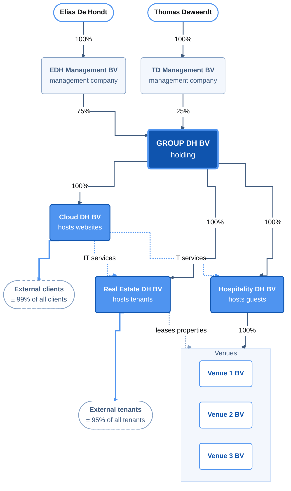

# Group DH

### Hosting, in every sense of the word.

We run the cloud, own the buildings and open the doors.

 

<a href="https://group-dh.com"><picture><source media="(prefers-color-scheme: dark)" srcset="../assets/button-website-dark.svg"/></picture></a>&nbsp;
<a href="mailto:info@group-dh.com"><picture><source media="(prefers-color-scheme: dark)" srcset="../assets/button-contact-dark.svg"/></picture></a>&nbsp;
<a href="mailto:security@group-dh.com"><picture><source media="(prefers-color-scheme: dark)" srcset="../assets/button-security-dark.svg"/></picture></a>

 

## How the group fits together

 

## Built by us, free for you

<table>
  <tr>
    <td align="center" valign="top" width="33%">
      
      <h3><a href="https://github.com/Group-DH/DHMail">DHMail</a></h3>
      Mail, calendar and contacts for Windows. Your mail stays on your own computer.
    </td>
    <td align="center" valign="top" width="33%">
      
      <h3><a href="https://github.com/Group-DH/DHFile">DHFile</a></h3>
      A tabbed file explorer for Windows with pinned folders and a PIN lock.
    </td>
    <td align="center" valign="top" width="33%">
      
      <h3><a href="https://github.com/Group-DH/DHTerminal">DHTerminal</a></h3>
      Every shell and WSL distro on your PC in one tabbed terminal.
    </td>
  </tr>
</table>

 

💙🤍 &nbsp; © Group DH &nbsp;·&nbsp; [group-dh.com](https://group-dh.com) &nbsp;·&nbsp; [Privacy Policy](https://group-dh.com/privacypolicy) &nbsp;·&nbsp; [Legal Guidelines](https://group-dh.com/legalguidelines) &nbsp; 💙🤍

