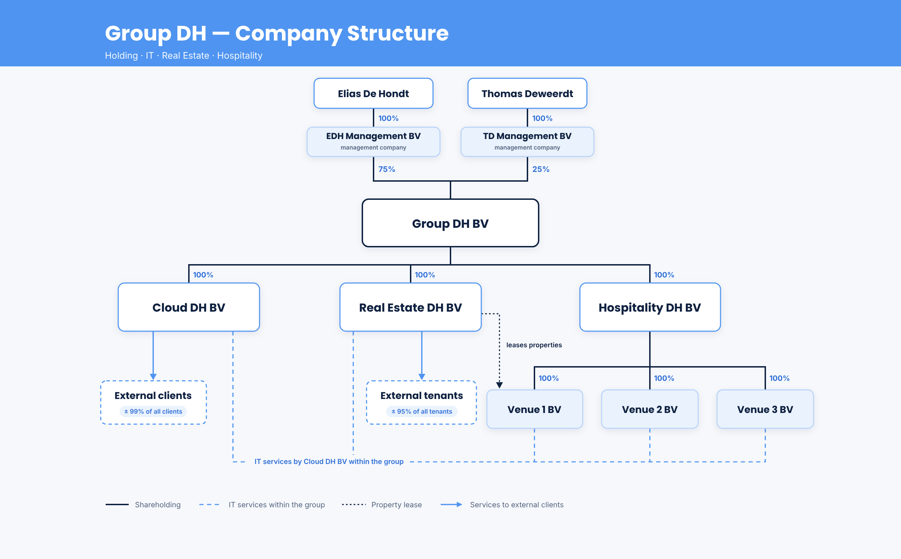

# Group DH

### Hosting, in every sense of the word.

We run the cloud, own the buildings and open the doors.

 

 

## How the group fits together

 

## Built by us, free for you

<table>
  <tr>
    <td align="center" valign="top" width="33%">
      
      <h3><a href="https://github.com/Group-DH/DHMail">DHMail</a></h3>
    </td>
    <td align="center" valign="top" width="33%">
      
      <h3><a href="https://github.com/Group-DH/DHFile">DHFile</a></h3>
    </td>
    <td align="center" valign="top" width="33%">
      
      <h3><a href="https://github.com/Group-DH/DHTerminal">DHTerminal</a></h3>
    </td>
  </tr>
</table>

 

💙🤍 &nbsp; © Group DH &nbsp;·&nbsp; [group-dh.com](https://group-dh.com) &nbsp;·&nbsp; [Privacy Policy](https://group-dh.com/privacypolicy) &nbsp;·&nbsp; [Legal Guidelines](https://group-dh.com/legalguidelines) &nbsp; 💙🤍

